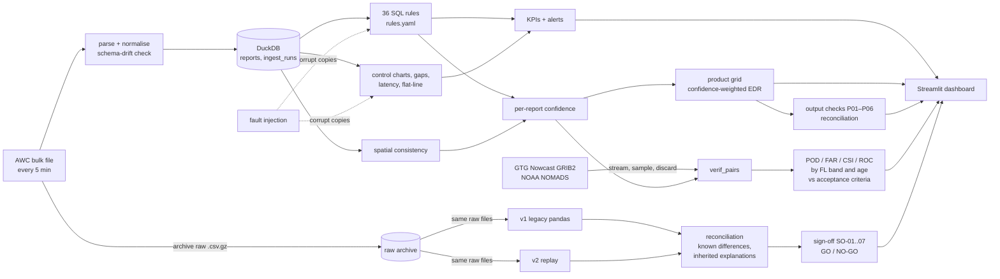

# TurbQC: a quality-control module for turbulence data

A near-real-time **data quality monitor for public turbulence reports**. It ingests the
NOAA Aviation Weather Center feed every few minutes into DuckDB. It then validates every
report against a 36-rule SQL catalogue, watches each delivery channel statistically,
scores how far each report can be trusted, and publishes a confidence-weighted turbulence
grid with its own reconciliation controls. It **tests itself** by injecting known faults
and measuring what it catches. It **verifies the NWS GTG turbulence nowcast** against those
QC-checked reports by flight level and nowcast age, against explicit acceptance criteria.
It also carries a **migration in miniature**: a legacy pandas pipeline run in parallel with
the SQL one, reconciled automatically down to every discrepancy, with a GO/NO-GO sign-off.

> Personal, non-commercial portfolio project built on public data only. Not affiliated
> with any airline, vendor or industry body.

---

## What makes it different

Most data-quality tools stop at "pass / fail". TurbQC adds seven things:

1. **Confidence instead of a binary filter.** Every report gets a 0–1 confidence built from
   rule results, latency, the source's recent reliability (a Beta posterior), agreement with
   nearby aircraft and how subjective the report type is. The output grid carries a
   confidence next to every EDR value (`1 − ∏(1 − cᵢ)` per cell), so consumers see how
   much to trust each number, not just the number.
2. **A monitor that measures itself.** A fault-injection harness corrupts copies of the
   data in 10 realistic ways (clock drift, a relay going dark, a replayed feed, frozen
   position source, metres decoded as feet, a fake severe report, and more). It reruns every
   check and reports recall, false alarms and **collateral** flags, the untouched reports
   a fault genuinely corrupts, separately so nothing is hidden.
3. **Decoded fields cross-checked against the original message.** Flight level, position
   and time are re-read from the raw AIREP/PIREP text. This catches faults that range
   checks cannot: an altitude in metres is still "in range", and a 6-minute clock drift
   looks normal. On the first 1,839 live reports these checks raised zero false positives.
4. **Monitoring the monitor.** Every poll is logged, including failures and schema drift.
   An hour only counts as observed if the collector's polls fully cover it, so an outage
   of the collector raises one `collector_gap` alert instead of false dropouts on every
   source.
5. **Docs as code with traceability.** The rule catalogue, data dictionary and
   requirement → rule → test matrix are generated from the same YAML the pipeline runs
   on. CI fails if a rule has no failing test case or if the docs drift.
6. **Verification that accounts for observation quality.** The GTG Nowcast is scored three
   ways: on all reports, on QC-passed reports, and with each report weighted by its
   confidence. It is scored at nowcast ages of 0–120 min, which shows how stale the product
   can get before skill drops: an acceptance criterion, not just a statistic. The 28 MB GRIB2
   files are streamed and sampled in memory with ecCodes, and nothing is stored.
7. **Reconciliation where every discrepancy must be explained.** In the v1 → v2 parallel
   run, field and rule-flag differences must match an approved *known difference*.
   Accept/reject differences and aggregate totals must *inherit* their explanation from
   the record-level differences that cause them. An aggregate mismatch with no
   record-level cause is flagged as an aggregation defect. On live data this caught a real
   v2 data-loss bug ([DEF-01](docs/migration.md#4-defects-found-by-the-reconciliation)).

## Results

**Fault injection** (5 days of synthetic traffic, 53k reports; reproduce with `python -m turbqc demo`):

| Scenario | Level | Injected | Recall | Collateral | False alarms | Caught by |
|---|---|---|---|---|---|---|
| Clock drift +20 min, 3 h | row | 500 | 100% | 19 | 0 | R030, R057, R031, R050 |
| Clock drift −6 min, 2 h (subtle) | row | 270 | 100% | 0 | 0 | R057 (message time cross-check only) |
| Relay traffic replayed twice | row | 56 | 100% | 0 | 0 | R040 |
| Frozen position source, 8 flights | row | 127 | 100% | 0 | 0 | R052, R054 |
| 3° position jumps, 15 flights | row | 15 | 100% | 0 | 0 | R054, R050 (11 of 15) |
| Altitude decoded in metres | row | 194 | 100% | 0 | 0 | R053 (no range rule can see it) |
| Calm PIREPs rewritten as SEV | row | 10 | 100% | 2 | 2 | R055 spatial consistency |
| Relay dark for 2 h | event | 1 | 100% | – | 0 | dropout, gap |
| Relay 40 min late for 2 h | event | 1 | 100% | – | 0 | latency p95, gap |
| Temperature stuck at −45 °C | event | 1 | 100% | – | 0 | flat-line |

The CI acceptance gate is recall ≥ 95% and false-alarm rate < 0.1% for every scenario.

**Live feed, first poll (24 Oct 2026)**: 1,840 reports (91% AIREP, 9% PIREP). One line looked
malformed and was dropped; the migration reconciliation later proved it was a valid report
([DEF-01](docs/migration.md#4-defects-found-by-the-reconciliation)). 18 AIREPs (1%) were *conflicting duplicates*: the same callsign at the same minute
with different positions, delivered via different paths. PIREP p95 latency was 25 min,
above the 15-min SLA.

**GTG Nowcast verification, real data** (22–24 Oct 2026: 1,849 turbulence reports, 81 GTGN
analyses streamed from NOMADS, 7,218 matched pairs; QC-passed reports, 20 km
neighbourhood, event = MOD+, forecast = EDR ≥ 0.20):

| Nowcast age | Pairs | MOD+ events | POD | FAR | CSI (90% CI) | ROC area |
|---|---|---|---|---|---|---|
| 0 min | 1,784 | 413 | 0.51 | 0.62 | 0.28 (0.25–0.31) | 0.72 |
| 30 min | 1,760 | 406 | 0.48 | 0.63 | 0.27 | 0.70 |
| 60 min | 1,733 | 396 | 0.44 | 0.66 | 0.24 | 0.69 |
| 120 min | 1,691 | 382 | 0.44 | 0.65 | 0.24 | 0.69 |

What the numbers say:

* **Cruise levels fail the illustrative acceptance criteria at a single EDR threshold.**
  At FL300–400, POD is only 0.35 at EDR ≥ 0.20, although ROC area is 0.73. The nowcast
  discriminates, but its EDR values at cruise sit lower. The threshold that maximises
  Peirce skill there is 0.14 (POD 0.71, CSI 0.36). Acceptance criteria and alert
  thresholds should be set per flight-level band, not globally.
* **Freshness matters most at cruise.** CSI at FL300–400 drops 27% when the nowcast is
  60 minutes old, against under 15% in the other bands.
* **Matching method changes the verdict.** A strict grid-point match gives POD 0.27 vs
  0.51 for the 20 km neighbourhood, at similar ROC area. PIREP position error, not only
  forecast error, drives the point scores.
* **QC barely moved these scores** (3 of 1,787 reports rejected). This is shown
  explicitly rather than assumed: the dashboard scores all, QC-passed and
  confidence-weighted reports side by side.

Caveat: pilots report more when it is bumpy, so these are conditional scores on a 2-day
sample. Run `verify` daily to build a longer record.

**Migration parallel run: v1 (legacy pandas) vs v2 (SQL)** ([approach](docs/migration.md)):

| Run | Batches | Discrepancies | Unexplained | Decision | Evidence |
|---|---|---|---|---|---|
| Synthetic, 5 days with incidents | 5 / 5 green | 2,116 | 0 | **GO** | [reports/parallel_run_demo.md](reports/parallel_run_demo.md) |
| Live archive, first run | 0 / 1 green | 30 | 2 (missing report, volume total) | NO-GO | DEF-01 found |
| Live archive, after the DEF-01 fix | 1 / 1 green | 28 | 0 | NO-GO: SO-07 needs 3 consecutive days | [reports/parallel_run_live.md](reports/parallel_run_live.md) |

* Every discrepancy is explained by one of four approved known differences (second
  turbulence layer, millisecond timestamps, speed-check blame logic, new rules) or
  inherited from them. KD-01 shows up on real data too: 7 live PIREPs had a more severe
  second layer that v1 ignored.
* **DEF-01, a real defect found by the reconciliation:** the provider doesn't quote the
  free-text field, and a pilot's comma split one line. v2 dropped the report; v1 kept it.
  The fix and a regression test are in, and the rerun is green.

## Be honest about the data

The public feed is **mostly position reports and subjective pilot reports. It contains no
aircraft-computed EDR.** TurbQC treats ACARS AIREPs as the stand-in for an automated airline
stream: high volume and kinematically checkable. It converts PIREP intensities into an
**EDR estimate** using bands anchored on the ICAO Annex 3 thresholds (moderate > 0.20,
severe > 0.45) and labels it as an estimate everywhere. The mapping is configuration, not
code. See [docs/methods.md](docs/methods.md).

## Capability map

| Capability | Where |
|---|---|
| **Governance & control**: requirements, validation rules, business rules, thresholds, acceptance criteria | [config/requirements.yaml](config/requirements.yaml), [config/rules.yaml](config/rules.yaml), [config/settings.yaml](config/settings.yaml) |
| Quality KPIs, dashboards, alerts | [turbqc/kpis.py](turbqc/kpis.py), [app/dashboard.py](app/dashboard.py), [docs/kpi_definitions.md](docs/kpi_definitions.md) |
| Separate controls for **input** streams and the **output** dataset | rules + analytics (input); `product_checks` P01–P06 (output) |
| **Data science for DQ**: statistical profiling, anomaly detection, trend analysis | robust control charts (median/MAD, hour-of-day baseline, learning period), latency trend, flat-line and gap detection, spatial consistency: [turbqc/analytics.py](turbqc/analytics.py) |
| Near-real-time pipeline | 5-minute collector with raw archive and replay: [turbqc/ingest.py](turbqc/ingest.py); hourly GitHub Action builds history: [.github/workflows/collect.yml](.github/workflows/collect.yml) |
| **Migration & reconciliation**: pre-migration profiling, legacy vs new, discrepancy tracking, sign-off criteria, cutover readiness, post-migration stabilisation | v1/v2 parallel run on the same raw files, discrepancy register with known differences and inherited explanations, SO-01..SO-07 GO/NO-GO, markdown evidence pack: [turbqc/migration.py](turbqc/migration.py), [config/migration.yaml](config/migration.yaml), [docs/migration.md](docs/migration.md); product input→output reconciliation (P01) |
| **Acceptance testing**: test scripts, execution tracking, quality and latency standards | [docs/test_plan.md](docs/test_plan.md), 88 pytest tests, CI gate on fault-injection recall and false-alarm rate |
| **Acceptance criteria and validation metrics for nowcast products** | GTG Nowcast verification: POD, FAR, CSI, Peirce skill, ROC area with bootstrap CIs by flight-level band and nowcast age; pass/fail against criteria in `settings.yaml`: [turbqc/verify.py](turbqc/verify.py), [methods §9](docs/methods.md) |
| Per-contributor follow-up | scorecards by source and by operator (ICAO designator) in the dashboard |
| **Documentation**: dictionary, rules, methods, test plan, KPIs, traceability | [docs/](docs/) (catalogue, dictionary and traceability are generated) |

## Quick start

```bash
python -m venv .venv && .venv\Scripts\activate        # macOS/Linux: source .venv/bin/activate
pip install -r requirements.txt

python -m turbqc demo              # offline demo DB: 5 days synthetic traffic + incidents + fault scores
python -m turbqc ingest            # one live poll of aviationweather.gov, then all checks
streamlit run app/dashboard.py     # dashboard (switch between Live and Demo in the sidebar)
pytest                             # 88 tests
```

Keep collecting (the AWC API keeps only ~15 days):

```bash
python -m turbqc ingest --loop                 # every 5 min while the terminal is open
powershell -File scripts/schedule_windows.ps1  # or two Windows scheduled tasks (no admin needed):
                                               #   TurbQC-Collector  every 5 min   python -m turbqc ingest
                                               #   TurbQC-Daily      06:30 daily   python -m turbqc daily
```

`daily` back-fills PIREPs, verifies the GTG Nowcast and runs the v1/v2 parallel run, each step
independent, logging to `data/logs/`. It opens the database only for short writes, so the
5-minute collector (a separate process; DuckDB allows one writer) is never blocked for long.

or enable the hourly **collect** GitHub Action, which commits deduplicated daily Parquet to a
`data` branch. Load it with `python -m turbqc replay data/history`.

Verify the GTG Nowcast by hand (the daily job does this; NOMADS keeps only ~2 days):

```bash
python -m turbqc verify --backfill     # pull 48 h of PIREPs, stream matching GTGN analyses, print scores
```

Parallel-run the legacy and new pipelines on the archived raw files and get a GO/NO-GO:

```bash
python -m turbqc reconcile --report reports/parallel_run_live.md
```

Other commands: `refresh` (rerun checks), `faults` (fault injection on the latest 24 h of
live data), `docs` (regenerate docs), `replay DIR` (rebuild from archives).

## How it works



```
config/        requirements, rule catalogue, thresholds (the governed part)
turbqc/        feed, ingest, rules engine, analytics, kpis, product, verify, faults, synthetic, docs,
               legacy (v1), migration (reconciliation)
app/           Streamlit dashboard
tests/         pytest suite + rule_cases.yaml (data-driven rule tests)
docs/          methods, KPIs, test plan + generated catalogue, dictionary, traceability
reports/       generated sign-off evidence packs (parallel runs)
scripts/       GitHub-Action collector, Windows scheduler
```

## Roadmap

- [x] Phase 1: ingest, rule catalogue, dashboard
- [x] Phase 2: statistical analytics, fault injection
- [x] Phase 3: **nowcast verification**. GTG Nowcast vs reports by flight-level band and
      nowcast age, with confidence intervals, QC-aware subsets and acceptance criteria.
- [ ] GTG *forecast* lead times, if a public GRIB feed of the forecast grids becomes
      available (only the nowcast is on NOMADS).
- [x] Phase 4: **migration exercise**. v1 pandas vs v2 SQL parallel run with automatic
      reconciliation, a discrepancy register, known differences and GO/NO-GO sign-off.
- [ ] Calibrate the confidence factors against later confirmation by other aircraft.
- [ ] Aircraft-size-aware PIREP → EDR mapping (light jets vs widebodies).

## Data source

NOAA / National Weather Service Aviation Weather Center,
[Data API](https://aviationweather.gov/data/api/), and the GTG Nowcast on
[NOAA NOMADS](https://nomads.ncep.noaa.gov/pub/data/nccf/com/gtgn/prod/). US government
data, used under its public terms. Please keep polling polite: the default is one request every 5 minutes with a
descriptive User-Agent.
